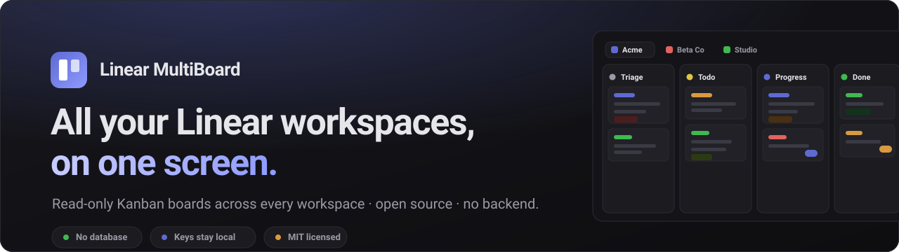
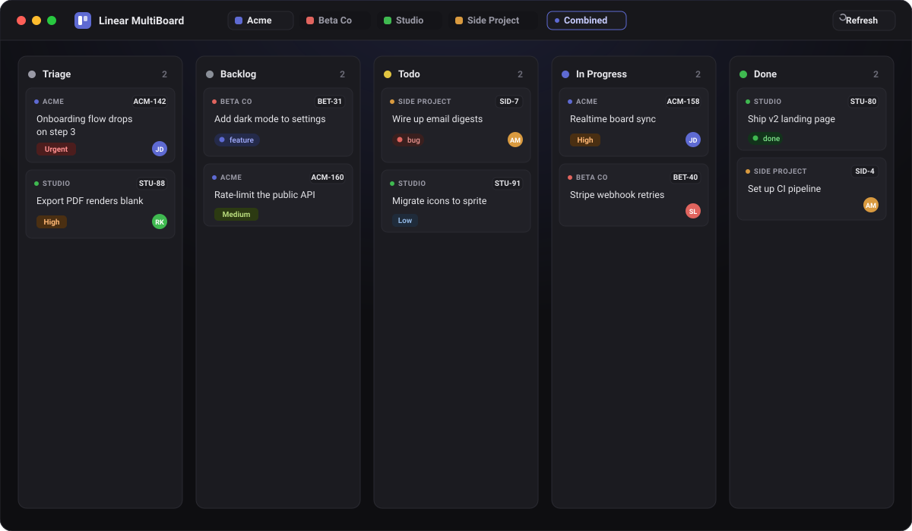

<p align="center">
  
</p>

<h1 align="center">Linear MultiBoard</h1>

<p align="center">
  View <strong>all of your Linear workspaces</strong> as Kanban boards on one screen.<br/>
  Read-only, open source, <strong>no database · no backend · no OAuth</strong>.
</p>

<p align="center">
  <a href="https://linearmultiboard.bhavikmistry.com"><strong>🌐 linearmultiboard.bhavikmistry.com</strong></a>
  &nbsp;·&nbsp;
  <a href="#setup">Setup</a>
  &nbsp;·&nbsp;
  <a href="#how-it-works">How it works</a>
</p>

<p align="center">
  
  
  
  
</p>

<p align="center">
  
</p>

---

Read-only, purely reading from the Linear API — **no database, no backend, no
OAuth**. Your workspace API keys live only in a local JSON file that is never
committed.

- One tab per workspace (organization) across the top.
- Per workspace, pick a team and see its issues in a Linear-style Kanban board,
  columns ordered Triage → Backlog → Todo → In Progress → Done.
- Cards show identifier, priority, labels, and assignee; click a card to open it
  in Linear.

> **Website:** the marketing page lives at
> **[linearmultiboard.bhavikmistry.com](https://linearmultiboard.bhavikmistry.com)**
> (source in [`landing/`](landing/), hosted on AWS Amplify).

## How it works

Linear settings — including personal API keys — are scoped to a **single
workspace**. So to show several workspaces you create one personal API key in
**each** workspace and list them in `public/linear.config.json`. On load the app
resolves each key to its organization and renders it as its own tab.

Because Linear's GraphQL endpoint doesn't send permissive CORS headers to
arbitrary origins, the Vite dev server proxies `/graphql` to `api.linear.app`
(see `vite.config.ts`). This is why the app is meant to be run via `npm run dev`
— there's still no backend of our own.

## Setup

### 1. Create a personal API key in each workspace

In Linear, switch to a workspace and go to **Settings → Security & access →
Personal API keys** (https://linear.app/settings/account/security) and create a
key. Repeat in every workspace you want to see. A key grants access to the one
workspace it was created in.

### 2. Configure the app

```bash
cp public/linear.config.example.json public/linear.config.json
```

Edit `public/linear.config.json` — one entry per workspace:

```json
{
  "workspaces": [
    { "label": "Acme",  "apiKey": "lin_api_xxxxxxxxxxxx" },
    { "label": "Beta Co", "apiKey": "lin_api_yyyyyyyyyyyy" }
  ]
}
```

`label` is optional (it only names a key in error messages — the real workspace
name is fetched from Linear). `public/linear.config.json` is git-ignored so your
keys never get committed.

### 3. Run

```bash
npm install
npm run dev
```

Open http://localhost:5173. Each workspace appears as a tab. After editing the
JSON, click **Reload config** (or refresh the page) to pick up changes.

## Notes

- Boards fetch up to 150 active (non-canceled) issues per team, plus up to 10
  labels per card — page sizes kept modest to stay under Linear's GraphQL
  query-complexity limit. Use **Refresh** to re-pull from the API.
- Nothing is written back to Linear — this is a read-only viewer.
- `npm run build` produces a static bundle, but the dev-server proxy won't exist
  there; if you deploy it, front it with an equivalent proxy for `/graphql` →
  `https://api.linear.app`, and note that `public/linear.config.json` would be
  served publicly — don't deploy it with real keys.

## Project layout

```
public/
  linear.config.example.json   template — copy to linear.config.json
  linear.config.json           your API keys (git-ignored)
src/
  linear/
    config.ts    loads + validates public/linear.config.json
    api.ts       GraphQL client + queries (org, teams, states, issues)
    types.ts     API + config types
  components/
    App is in src/App.tsx (workspace tabs + orchestration)
    WorkspaceBoard.tsx   team picker + board for one workspace
    Board.tsx            columns grouped by workflow state
    IssueCard.tsx        a single issue card
    SetupScreen.tsx      first-run instructions when no config exists
```

## License

Licensed under the [MIT License](LICENSE) — free to use, modify, and distribute,
including commercially. Just keep the copyright and license notice.

© 2026 Bhavik Mistry

Not affiliated with or endorsed by Linear. “Linear” is a trademark of Linear
Orbit, Inc.
